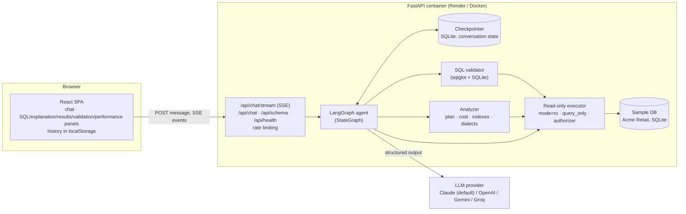
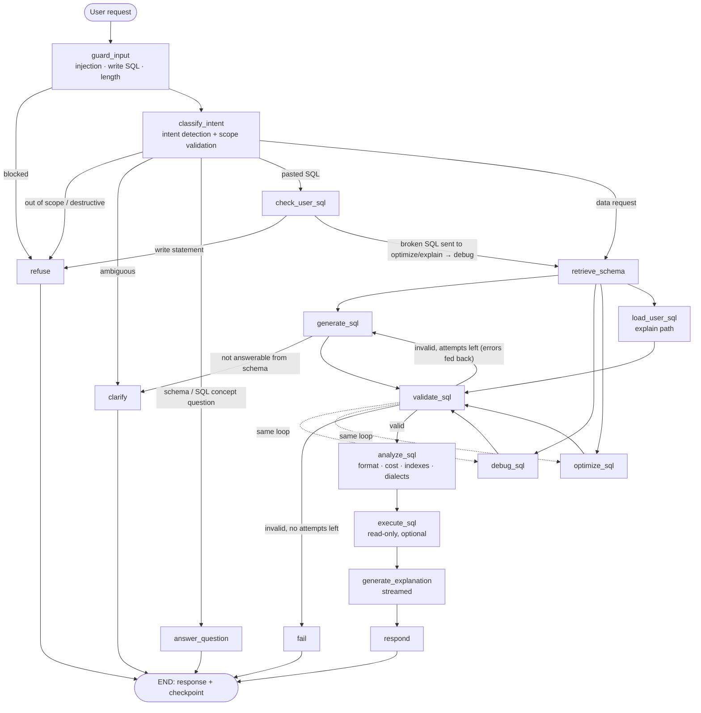

# SQL Query Agent

A task-focused AI agent that turns plain-English questions into **validated, read-only SQL**, explains it, runs it against a sample database, and also **optimizes** and **debugs** queries you paste in. Anything unrelated to SQL or the database is refused.

Built with **LangGraph** (orchestration), **FastAPI** (API + SSE streaming), **React + TypeScript** (UI), **SQLite** (sample database) and **sqlglot** (deterministic SQL analysis).

| | |
|---|---|
| **Live demo** | _https://&lt;your-service&gt;.onrender.com_ (no login required) |
| **Demo video** | _link to the 3–5 minute walkthrough_ |
| **Docs** | [Architecture](docs/ARCHITECTURE.md) · [Prompts](docs/PROMPTS.md) · [Sample schema](docs/SCHEMA.md) · [Demo script](docs/DEMO_SCRIPT.md) |

> The free Render instance sleeps when idle; the first request can take ~30–50 s to wake it.

---

## What it does

| Requirement | How it is met |
|---|---|
| Natural language → SQL | `generate_sql` node with the retrieved schema, conversation history and the previous query |
| Validation before returning SQL | Deterministic validator: syntax, read-only AST check, table/column existence with "did you mean" hints, FK-aware join checks, and a SQLite compile (`EXPLAIN QUERY PLAN`) |
| Never destructive | Four independent layers (see [Guardrails](#guardrails)); the database connection itself is read-only |
| Explanation | `generate_explanation` node, streamed token by token to the UI |
| Optimization | Readability, sargable rewrites, unnecessary-join removal and index advice, plus a check that the original and optimized queries return the same rows on the sample data |
| Debugging | Validator diagnostics are given to the LLM, which lists each issue with an explanation; the fix is validated again |
| Conversation context | LangGraph checkpointer per conversation; follow-ups modify the previous query |
| Out-of-scope refusal | Router classifies scope; fixed refusal text from the spec |
| Ambiguity | Router or generator asks a clarifying question instead of guessing |

**Bonus features implemented:** SQL execution (read-only, row cap, timeout) · follow-up support · query cost estimation from the SQLite query plan · syntax highlighting · SQLite / PostgreSQL / MySQL output · CSV export · download `.sql` · prompt-injection protection · dark mode · streaming responses · Docker deployment · 104 unit and integration tests.

---

## Architecture



The LLM is only asked to do what needs language understanding: routing, writing SQL, diagnosing and explaining. Everything that can be checked mechanically (scope keywords, schema names, joins, read-only status, cost, execution) runs as deterministic code the model cannot bypass. More detail is in [docs/ARCHITECTURE.md](docs/ARCHITECTURE.md).

## LangGraph workflow



| Node | Type | Responsibility |
|---|---|---|
| `guard_input` | deterministic | Blocks empty/oversized input, prompt-injection patterns and explicit write statements before any LLM call |
| `classify_intent` | LLM (structured) | One of `generate_sql`, `optimize_sql`, `debug_sql`, `explain_sql`, `database_question`, `destructive`, `clarify`, `out_of_scope`; extracts pasted SQL; detects references to the previous query |
| `check_user_sql` | deterministic | Validates pasted SQL; refuses write statements; reroutes broken SQL to debugging |
| `retrieve_schema` | deterministic | IDF-weighted lexical scoring of tables (names, descriptions, synonyms, columns) plus foreign-key join-path completion; the other tables are passed as one-line summaries |
| `generate_sql` / `debug_sql` / `optimize_sql` | LLM (structured) | Produce candidate SQL; on retry they receive the validator's errors and, after a name error, the full schema |
| `validate_sql` | deterministic | See [Guardrails](#guardrails); loops back to the producer up to `MAX_SQL_ATTEMPTS` (3) |
| `analyze_sql` | deterministic | Formatting, cost estimate from `EXPLAIN QUERY PLAN` + `sqlite_stat1`, index suggestions, PostgreSQL/MySQL translation with portability notes |
| `execute_sql` | deterministic | Read-only execution (200-row cap, 5 s timeout); for optimizations, compares original and optimized result sets |
| `generate_explanation` | LLM (streamed) | Plain-English explanation for business users |
| `respond` / `refuse` / `clarify` / `answer_question` / `fail` | terminal | Build the response and append the turn to the checkpointed conversation |

## Guardrails

Destructive SQL has to get past four independent layers:

1. **Input guard** (regex, before the LLM): explicit `DELETE/UPDATE/INSERT/DROP/ALTER/TRUNCATE/CREATE/ATTACH/GRANT…` statements and prompt-injection phrases are refused immediately.
2. **Router** (LLM): natural-language write requests ("remove all cancelled orders") are classified `destructive` and politely refused.
3. **Validator** (AST): the statement must be a single `SELECT`/`WITH` query. The parse tree is walked for any DML/DDL/admin node, including writes hidden inside CTEs, with a keyword backstop on literal-stripped text.
4. **Database**: the SQLite file is opened `mode=ro`, `PRAGMA query_only=ON`, and an authorizer callback denies everything except reads. Tests show writes fail even when the validator is bypassed.

**No hallucinated names:** every table and column is resolved against the live catalog, and SQLite must compile the query. Errors are fed back to the model with suggestions ("Table 'Employee' does not exist. Did you mean Employees?") for up to three self-correction rounds. If it still fails, the user gets an error, never unvalidated SQL.

**Prompt-injection protection:** injection patterns are refused before the LLM. All untrusted text (the message, the history, pasted SQL) is wrapped in tags that the system prompts declare to be data. Attempts to change the assistant's role are classified `out_of_scope`. The model has no tools: it can only return structured output, which the code validates.

**Abuse limits:** per-IP rate limit (client-supplied `X-Forwarded-For` entries are not trusted), one in-flight request per conversation, a 4,000-character input limit, a 200-row result cap, a 1 MB per-value limit and a 5 s query timeout. System and extension functions (`load_extension`, `pragma_*`, …) are rejected, and example queries inside free-text answers are validated too.

## Conversation management

- Each browser conversation has a UUID used as the LangGraph `thread_id`. The `AsyncSqliteSaver` checkpointer persists `messages` and `last_sql` between turns, and every other state field is reset per turn (`new_turn()`).
- Prompts include the last 6 turns and the previous validated query. The router flags follow-ups (`refers_to_previous_sql`), so "Only those from California" modifies `SELECT * FROM Customers` instead of starting over, and "optimize it" or "explain that" act on the previous query.
- The UI keeps the conversation list in `localStorage`. Deleting a conversation also deletes its server-side checkpoint.

---

## Run locally

Prerequisites: Python 3.12+, Node 18+, and an Anthropic, OpenAI, Google Gemini or Groq API key (Gemini and Groq have free tiers: create a key at [Google AI Studio](https://aistudio.google.com/apikey) or the [Groq console](https://console.groq.com/keys)).

```bash
# 1. Backend
cd backend
python -m venv .venv && source .venv/bin/activate
pip install -r requirements-dev.txt
cp .env.example .env            # then set ANTHROPIC_API_KEY (or LLM_PROVIDER=openai + OPENAI_API_KEY, or LLM_PROVIDER=gemini + GEMINI_API_KEY, or LLM_PROVIDER=groq + GROQ_API_KEY)
python -m app.db.seed           # builds data/acme.db (also done automatically on startup)
uvicorn app.main:app --reload --port 8000

# 2. Frontend (new terminal)
cd frontend
npm install
npm run dev                     # http://localhost:5173 (proxies /api to :8000)
```

**Single container** (serves the built UI and the API on one port):

```bash
docker compose up --build       # http://localhost:8000, reads backend/.env
```

**Tests** (no API key needed; the LLM is replaced by a scripted fake):

```bash
cd backend && pytest            # 123 tests: validator, executor, guards, retrieval, analyzer, graph flows, API/SSE
```

### Deploy to Render

1. Push the repository to GitHub.
2. In Render choose **New → Blueprint**, select the repo, and Render reads [`render.yaml`](render.yaml).
3. Set `GROQ_API_KEY` (and optionally `GEMINI_API_KEY`, which turns on the automatic Gemini fallback) when prompted, then deploy. The Docker image builds the frontend, installs the backend, and seeds the database. To switch providers later, change `LLM_PROVIDER` in the Render dashboard.

The free instance (512 MB RAM, 0.1 CPU) sleeps after 15 minutes without traffic and takes about a minute to wake, and its disk resets on every restart, so the server forgets conversation context for follow-ups. Before a demo, open the URL a couple of minutes early; a free uptime monitor pinging `/api/health` every 10 minutes keeps it awake (one always-on service fits in the 750 free hours a month).

### Configuration

| Variable | Default | Purpose |
|---|---|---|
| `LLM_PROVIDER` | `anthropic` | Any provider supported by LangChain `init_chat_model` (`anthropic`, `openai`, `google_genai`, `groq`, …); `gemini` is an alias for `google_genai` |
| `LLM_MODEL` | `claude-opus-5-5` (`gpt-4.1` for OpenAI, `gemini-3.8-flash` for Gemini, `openai/gpt-oss-120b` for Groq) | Model for SQL generation, debugging and optimization |
| `LLM_FAST_MODEL` | same as `LLM_MODEL` (`gemini-3.5-flash-lite` for Gemini, `openai/gpt-oss-20b` for Groq) | Optional cheaper model for routing and explanations |
| `LLM_FALLBACK_PROVIDER` | — | Backup provider (e.g. `gemini`) that automatically retries any call the primary fails, using its default models; needs its API key |
| `LLM_EFFORT` / `LLM_FAST_EFFORT` | `medium` / `low` | Claude effort, Gemini 3+ `thinking_level` or Groq gpt-oss `reasoning_effort`, for the two model roles |
| `ANTHROPIC_API_KEY` / `OPENAI_API_KEY` / `GEMINI_API_KEY` (or `GOOGLE_API_KEY`) / `GROQ_API_KEY` | — | Provider credentials |
| `MAX_SQL_ATTEMPTS` | `3` | Generation + self-correction rounds |
| `MAX_RESULT_ROWS` / `QUERY_TIMEOUT_S` | `200` / `5` | Execution limits |
| `RATE_LIMIT_PER_MINUTE` | `20` | Per-IP request limit |
| `TRUSTED_PROXY_HOPS` | `0` (`1` on Render) | Reverse proxies whose `X-Forwarded-For` entries are trusted for client IPs |

---

## Project structure

```
backend/
  app/
    main.py              FastAPI app: SSE streaming, rate limiting, static frontend
    config.py            Settings from environment
    agent/
      graph.py           LangGraph StateGraph wiring and routing
      nodes.py           Node implementations
      state.py           Graph state and per-turn reset
      prompts.py         All prompts (exported to docs/PROMPTS.md)
      models.py          Pydantic structured-output schemas
      guards.py          Deterministic input guardrails
      retrieval.py       Schema retrieval (IDF scoring + FK path completion)
      llm.py             Provider-agnostic model factory
    sql/
      validator.py       Read-only, schema, join and syntax validation
      analyzer.py        Formatting, cost estimate, index advice, dialect translation
    db/
      schema.sql         Sample schema (Acme Retail)
      seed.py            Deterministic data generator
      catalog.py         Schema introspection and rendering
      executor.py        Read-only SQLite execution
  scripts/generate_docs.py
  tests/                 Unit + integration tests with a scripted LLM
frontend/src/            React + TypeScript UI
docs/                    Architecture, prompts, schema, demo script
Dockerfile · docker-compose.yml · render.yaml
```

## Sample database

**Acme Retail** is an online retailer with 8 tables: `Departments`, `Employees`, `Customers`, `Categories`, `Products`, `Orders`, `OrderItems` and `Payments`. It holds about 6,000 rows of deterministic sample data (orders from Jan 2024 to Sep 2026). Column comments in [`schema.sql`](backend/app/db/schema.sql) carry descriptions and synonyms that ground the model. Full reference with an ER diagram: [docs/SCHEMA.md](docs/SCHEMA.md).

Some foreign keys are deliberately left unindexed (e.g. `Orders.OrderDate`, `Customers.State`, `OrderItems.ProductID`) so the optimizer has realistic index recommendations to make.

## Assumptions

- **Schema:** the brief says a schema "will be provided", but none came with the assignment. I designed one that mirrors the brief's examples (`Employees.HireDate`, `Customers.State`), so those prompts work unchanged.
- **Dialect:** SQLite is the execution and validation dialect. PostgreSQL and MySQL versions are automatic translations (sqlglot) for display and download. They are not executed, and SQLite-only functions are flagged.
- **Dates:** "after January 2024" follows the brief's example (`>= '2024-01-01'`). Relative dates use today's date, which is injected into the prompt. States are stored as two-letter codes (California → `'CA'`).
- **Execution:** queries run against the sample database only, read-only, capped at 200 rows and 5 s. Execution can be switched off in the UI ("Run queries").
- **Index recommendations** are advice only; the assistant never runs DDL.
- **Cost estimation** is a heuristic based on SQLite's query plan and index statistics, not a measured cost.
- **Access:** the demo is public with no login, protected by per-IP rate limiting. Conversation checkpoints live on the container's disk and reset on redeploys of the free instance; the UI keeps its own history in the browser.
- **Model:** Claude Opus 5.5 is the default. Set `LLM_MODEL=claude-sonnet-5-5` (or another provider) to trade some accuracy for cost.

## Limitations and next steps

- The cost model is heuristic; a PostgreSQL deployment could use real `EXPLAIN (FORMAT JSON)` costs.
- Schema retrieval is lexical. For schemas with hundreds of tables, embedding-based retrieval would be the next step.
- Running the generated SQL against real PostgreSQL/MySQL instances would validate the translated dialects too.
- An evaluation set of question → expected-result pairs (execution accuracy) would let prompt changes be measured instead of judged by eye.
