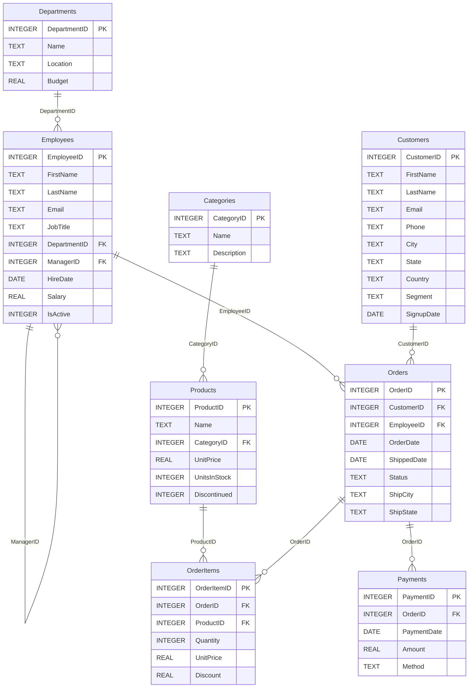

# Sample database schema

> Generated from the live SQLite database by `python -m scripts.generate_docs`.
> Source DDL: [`backend/app/db/schema.sql`](../backend/app/db/schema.sql); data: `backend/app/db/seed.py`
> (deterministic, seed 42).



## Departments

Business units of the company. Synonyms: department, dept, team, division, unit, budget — **8 rows**

| Column | Type | Key | Notes |
|---|---|---|---|
| `DepartmentID` | INTEGER | PK |  |
| `Name` | TEXT |  | Department name, e.g. 'Sales', 'Engineering'; values: `Customer Support`, `Engineering`, `Finance`, `Human Resources`, `Legal`, `Marketing`, `Operations`, `Sales` |
| `Location` | TEXT |  | Office city where the department is based; values: `Austin`, `Boston`, `Chicago`, `Los Angeles`, `New York`, `San Francisco`, `Seattle` |
| `Budget` | REAL |  | Annual budget in USD |

Indexes: `sqlite_autoindex_Departments_1(Name)`

## Employees

Company staff, including sales reps who handle orders. Synonyms: employee, staff, worker, colleague, rep, salesperson, hire, manager — **66 rows**

| Column | Type | Key | Notes |
|---|---|---|---|
| `EmployeeID` | INTEGER | PK |  |
| `FirstName` | TEXT |  |  |
| `LastName` | TEXT |  |  |
| `Email` | TEXT |  |  |
| `JobTitle` | TEXT |  |  |
| `DepartmentID` | INTEGER | FK → Departments.DepartmentID |  |
| `ManagerID` | INTEGER | FK → Employees.EmployeeID | The employee's manager; NULL for department heads |
| `HireDate` | DATE |  | ISO date 'YYYY-MM-DD'; range 2014-08-18 … 2026-05-21 |
| `Salary` | REAL |  | Annual salary in USD |
| `IsActive` | INTEGER |  | 1 = currently employed, 0 = has left the company |

Indexes: `idx_employees_department(DepartmentID)`, `sqlite_autoindex_Employees_1(Email)`

## Customers

People and businesses who place orders. Synonyms: customer, client, buyer, shopper, account — **300 rows**

| Column | Type | Key | Notes |
|---|---|---|---|
| `CustomerID` | INTEGER | PK |  |
| `FirstName` | TEXT |  |  |
| `LastName` | TEXT |  |  |
| `Email` | TEXT |  |  |
| `Phone` | TEXT |  |  |
| `City` | TEXT |  |  |
| `State` | TEXT |  | Two-letter US state code, e.g. 'CA' for California, 'NY' for New York |
| `Country` | TEXT |  | values: `USA` |
| `Segment` | TEXT |  | Customer segment; values: `Consumer`, `Corporate`, `Small Business` |
| `SignupDate` | DATE |  | ISO date the customer registered; range 2022-01-01 … 2026-06-30 |

Indexes: `sqlite_autoindex_Customers_1(Email)`

## Categories

Product categories. Synonyms: category, type, group, department of products — **6 rows**

| Column | Type | Key | Notes |
|---|---|---|---|
| `CategoryID` | INTEGER | PK |  |
| `Name` | TEXT |  | values: `Books`, `Electronics`, `Home & Kitchen`, `Office Supplies`, `Sports & Outdoors`, `Toys & Games` |
| `Description` | TEXT |  | values: `Cookware and home goods`, `Fitness and outdoor gear`, `Games and puzzles`, `Phones, laptops and accessories`, `Print and e-books`, `Stationery and office furniture` |

Indexes: `sqlite_autoindex_Categories_1(Name)`

## Products

Items the company sells. Synonyms: product, item, sku, goods, inventory, stock, catalog — **34 rows**

| Column | Type | Key | Notes |
|---|---|---|---|
| `ProductID` | INTEGER | PK |  |
| `Name` | TEXT |  |  |
| `CategoryID` | INTEGER | FK → Categories.CategoryID |  |
| `UnitPrice` | REAL |  | Current list price in USD |
| `UnitsInStock` | INTEGER |  | Units currently in the warehouse |
| `Discontinued` | INTEGER |  | 1 = no longer sold |

## Orders

Customer orders (one row per order). Synonyms: order, sale, purchase, transaction, shipment — **1,500 rows**

| Column | Type | Key | Notes |
|---|---|---|---|
| `OrderID` | INTEGER | PK |  |
| `CustomerID` | INTEGER | FK → Customers.CustomerID |  |
| `EmployeeID` | INTEGER | FK → Employees.EmployeeID | Sales rep who handled the order |
| `OrderDate` | DATE |  | ISO date the order was placed; range 2024-01-01 … 2026-09-30 |
| `ShippedDate` | DATE |  | NULL until the order ships; range 2024-01-05 … 2026-10-04 |
| `Status` | TEXT |  | Order lifecycle status; values: `Cancelled`, `Delivered`, `Pending`, `Returned`, `Shipped` |
| `ShipCity` | TEXT |  |  |
| `ShipState` | TEXT |  | Two-letter US state code of the shipping address |

Indexes: `idx_orders_customer(CustomerID)`

## OrderItems

Line items of each order; revenue = Quantity * UnitPrice * (1 - Discount). Synonyms: line item, item sold, units sold, revenue, sales amount — **2,928 rows**

| Column | Type | Key | Notes |
|---|---|---|---|
| `OrderItemID` | INTEGER | PK |  |
| `OrderID` | INTEGER | FK → Orders.OrderID |  |
| `ProductID` | INTEGER | FK → Products.ProductID |  |
| `Quantity` | INTEGER |  |  |
| `UnitPrice` | REAL |  | Price per unit at the time of sale |
| `Discount` | REAL |  | Fractional discount between 0 and 0.3 |

Indexes: `idx_orderitems_order(OrderID)`

## Payments

Payments received against orders. Synonyms: payment, paid, amount, charge, refund, billing — **1,431 rows**

| Column | Type | Key | Notes |
|---|---|---|---|
| `PaymentID` | INTEGER | PK |  |
| `OrderID` | INTEGER | FK → Orders.OrderID |  |
| `PaymentDate` | DATE |  | range 2024-01-03 … 2026-10-02 |
| `Amount` | REAL |  | Amount paid in USD |
| `Method` | TEXT |  | Payment method; values: `Bank Transfer`, `Credit Card`, `Gift Card`, `PayPal` |

Indexes: `idx_payments_order(OrderID)`

## DDL

```sql
-- Acme Retail sample database (SQLite).
--
-- Comments are part of the schema contract: the first comment inside each
-- CREATE TABLE is the table description and trailing "--" comments describe
-- columns. The agent reads them from sqlite_master to ground SQL generation,
-- so keep one column per line.

PRAGMA foreign_keys = ON;

CREATE TABLE Departments ( -- Business units of the company. Synonyms: department, dept, team, division, unit, budget
    DepartmentID INTEGER PRIMARY KEY,
    Name         TEXT    NOT NULL UNIQUE, -- Department name, e.g. 'Sales', 'Engineering'
    Location     TEXT    NOT NULL,        -- Office city where the department is based
    Budget       REAL    NOT NULL         -- Annual budget in USD
);

CREATE TABLE Employees ( -- Company staff, including sales reps who handle orders. Synonyms: employee, staff, worker, colleague, rep, salesperson, hire, manager
    EmployeeID   INTEGER PRIMARY KEY,
    FirstName    TEXT    NOT NULL,
    LastName     TEXT    NOT NULL,
    Email        TEXT    NOT NULL UNIQUE,
    JobTitle     TEXT    NOT NULL,
    DepartmentID INTEGER NOT NULL REFERENCES Departments(DepartmentID),
    ManagerID    INTEGER REFERENCES Employees(EmployeeID), -- The employee's manager; NULL for department heads
    HireDate     DATE    NOT NULL,        -- ISO date 'YYYY-MM-DD'
    Salary       REAL    NOT NULL,        -- Annual salary in USD
    IsActive     INTEGER NOT NULL DEFAULT 1 -- 1 = currently employed, 0 = has left the company
);

CREATE TABLE Customers ( -- People and businesses who place orders. Synonyms: customer, client, buyer, shopper, account
    CustomerID   INTEGER PRIMARY KEY,
    FirstName    TEXT    NOT NULL,
    LastName     TEXT    NOT NULL,
    Email        TEXT    NOT NULL UNIQUE,
    Phone        TEXT,
    City         TEXT    NOT NULL,
    State        TEXT    NOT NULL,        -- Two-letter US state code, e.g. 'CA' for California, 'NY' for New York
    Country      TEXT    NOT NULL DEFAULT 'USA',
    Segment      TEXT    NOT NULL,        -- Customer segment
    SignupDate   DATE    NOT NULL         -- ISO date the customer registered
);

CREATE TABLE Categories ( -- Product categories. Synonyms: category, type, group, department of products
    CategoryID   INTEGER PRIMARY KEY,
    Name         TEXT    NOT NULL UNIQUE,
    Description  TEXT
);

CREATE TABLE Products ( -- Items the company sells. Synonyms: product, item, sku, goods, inventory, stock, catalog
    ProductID    INTEGER PRIMARY KEY,
    Name         TEXT    NOT NULL,
    CategoryID   INTEGER NOT NULL REFERENCES Categories(CategoryID),
    UnitPrice    REAL    NOT NULL,        -- Current list price in USD
    UnitsInStock INTEGER NOT NULL,        -- Units currently in the warehouse
    Discontinued INTEGER NOT NULL DEFAULT 0 -- 1 = no longer sold
);

CREATE TABLE Orders ( -- Customer orders (one row per order). Synonyms: order, sale, purchase, transaction, shipment
    OrderID      INTEGER PRIMARY KEY,
    CustomerID   INTEGER NOT NULL REFERENCES Customers(CustomerID),
    EmployeeID   INTEGER NOT NULL REFERENCES Employees(EmployeeID), -- Sales rep who handled the order
    OrderDate    DATE    NOT NULL,        -- ISO date the order was placed
    ShippedDate  DATE,                    -- NULL until the order ships
    Status       TEXT    NOT NULL,        -- Order lifecycle status
    ShipCity     TEXT    NOT NULL,
    ShipState    TEXT    NOT NULL         -- Two-letter US state code of the shipping address
);

CREATE TABLE OrderItems ( -- Line items of each order; revenue = Quantity * UnitPrice * (1 - Discount). Synonyms: line item, item sold, units sold, revenue, sales amount
    OrderItemID  INTEGER PRIMARY KEY,
    OrderID      INTEGER NOT NULL REFERENCES Orders(OrderID),
    ProductID    INTEGER NOT NULL REFERENCES Products(ProductID),
    Quantity     INTEGER NOT NULL,
    UnitPrice    REAL    NOT NULL,        -- Price per unit at the time of sale
    Discount     REAL    NOT NULL DEFAULT 0 -- Fractional discount between 0 and 0.3
);

CREATE TABLE Payments ( -- Payments received against orders. Synonyms: payment, paid, amount, charge, refund, billing
    PaymentID    INTEGER PRIMARY KEY,
    OrderID      INTEGER NOT NULL REFERENCES Orders(OrderID),
    PaymentDate  DATE    NOT NULL,
    Amount       REAL    NOT NULL,        -- Amount paid in USD
    Method       TEXT    NOT NULL         -- Payment method
);

-- Only some foreign keys are indexed on purpose, so the optimizer has
-- realistic index recommendations to make (e.g. Orders.OrderDate,
-- Customers.State, OrderItems.ProductID).
CREATE INDEX idx_employees_department ON Employees(DepartmentID);
CREATE INDEX idx_orders_customer      ON Orders(CustomerID);
CREATE INDEX idx_orderitems_order     ON OrderItems(OrderID);
CREATE INDEX idx_payments_order       ON Payments(OrderID);
```
